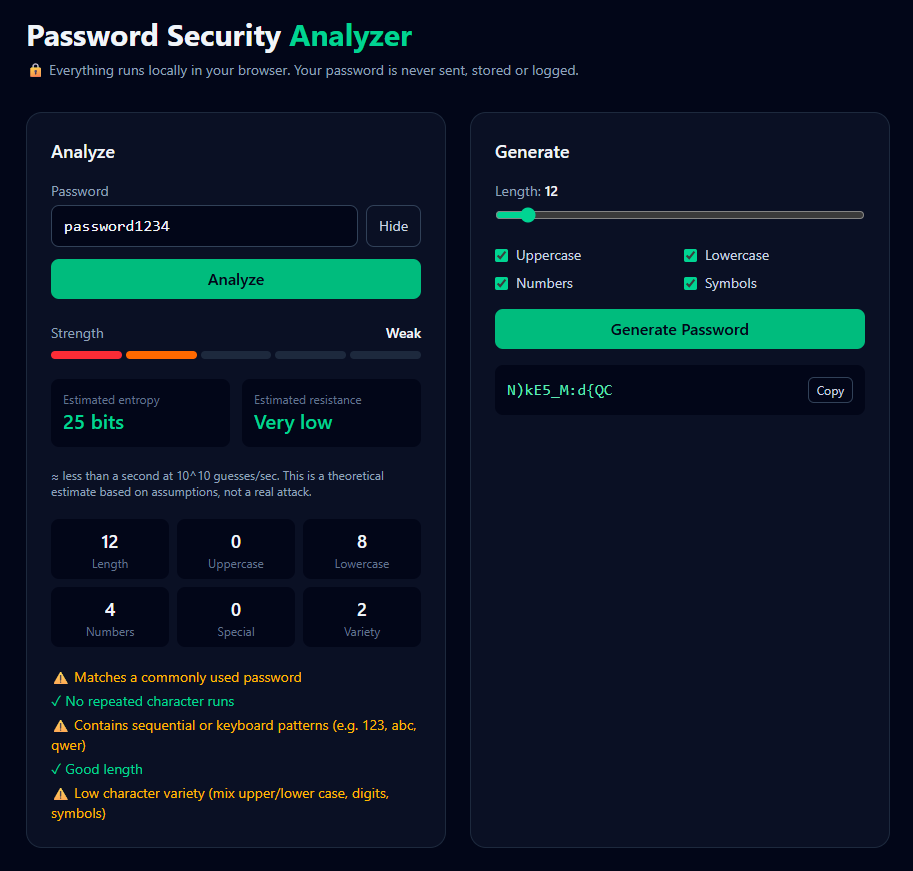

# 🔐 Password Security Analyzer

A small, privacy-first web app that analyzes password strength and generates secure passwords. All processing happens **in the browser** — passwords are never sent, stored or logged.


   
## Project Overview

Built with React, TypeScript, Vite and Tailwind CSS. The analysis logic lives in pure, unit-tested functions (`src/lib/analyzer.ts`), separated from the UI.

## Features

- Strength rating: Very Weak → Very Strong
- Length, uppercase, lowercase, number, special character counts and character variety
- Entropy estimate (bits)
- Theoretical brute-force resistance estimate
- Detection of common passwords, repeated characters and sequential/keyboard patterns
- Secure password generator using the Web Crypto API
- Show/hide password toggle
- Unit tests with Vitest

## How password strength is calculated

1. **Charset size** is derived from the character classes used (26 lowercase, 26 uppercase, 10 digits, 33 symbols).
2. **Predictable characters** (runs of 3+ identical or consecutive characters like `aaa`, `123`, `abc`) are not counted towards the effective length. Keyboard patterns (`qwer`, `asdf`…) subtract a fixed penalty.
3. **Common passwords** (local list in `src/data/commonPasswords.json`, including variants like `password123`) cap the entropy at 25 bits and the rating at *Weak*.
4. The final entropy is mapped to a rating:

| Entropy | Rating |
|---|---|
| < 20 bits | Very Weak |
| 20–35 bits | Weak |
| 36–59 bits | Medium |
| 60–99 bits | Strong |
| ≥ 100 bits | Very Strong |

Passwords shorter than 8 characters are capped at *Weak*.

## Entropy explanation

```
entropy = effective_length × log2(charset_size)
```

A 12-character password using all four character classes: `12 × log2(95) ≈ 79 bits`. Each additional bit doubles the number of guesses needed.

## Brute-force estimation limitations

The estimate assumes `average guesses = 2^entropy / 2` at **10^10 guesses/second**. It is a **theoretical model**, not a real attack, and:

- real speed depends heavily on the hash algorithm (bcrypt/Argon2 are far slower to attack than MD5),
- attackers use dictionaries, leaked lists and rules before brute force,
- dictionary-word passphrases (e.g. `CorrectHorseBattery`) are overestimated, since this tool does not perform word segmentation.

## Security considerations

- No backend, database, analytics or network requests — analysis is 100 % client-side.
- The password is never written to `console`, `localStorage` or any log.
- The input uses `autocomplete="off"` and `spellcheck="false"`.
- The generator uses `crypto.getRandomValues` with rejection sampling (no modulo bias) and a Fisher-Yates shuffle.
- Never test your real, in-use passwords in any online tool you don't fully trust.

## Installation

```bash
git clone https://github.com/<your-username>/password-security-analyzer.git
cd password-security-analyzer
npm install
```

## Usage

```bash
npm run dev     # start dev server
npm test        # run unit tests
npm run build   # production build
```

Type a password and click **Analyze**, or use the generator to create a random password.

## Screenshots


## Future improvements

- Optional FastAPI endpoint for breach checks via the HIBP k-anonymity API
- Larger common-password list (e.g. top 10k) loaded lazily
- Dictionary word segmentation and leetspeak detection
- Passphrase (Diceware) generator
- Dark/light theme toggle and i18n (TR/EN)

## License

MIT
